# Koipop

**Color theme** for VS Code, in **dark** and **light**. **UI elements** use a scale of _cool gray_ and are intended to be clean and consistent. **Code tokens** use _vibrant, assertive, bright_ colors and are intended to be readable, consistent, and quick for your eyes to scan.

Both themes use the same gray scale from opposite ends, and the same color for each kind of token: keywords pink, strings orange, functions green, classes yellow, types cyan, numbers and constants purple.

## Koipop Dark

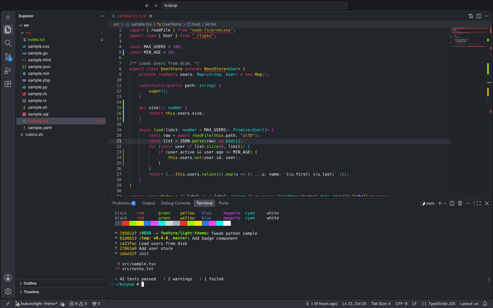

## Koipop Light

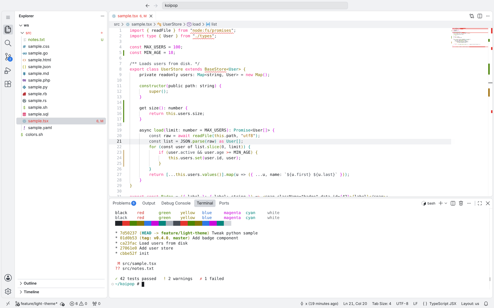

## Languages

Each pair shows Koipop Dark on the left and Koipop Light on the right.

**TypeScript and React**

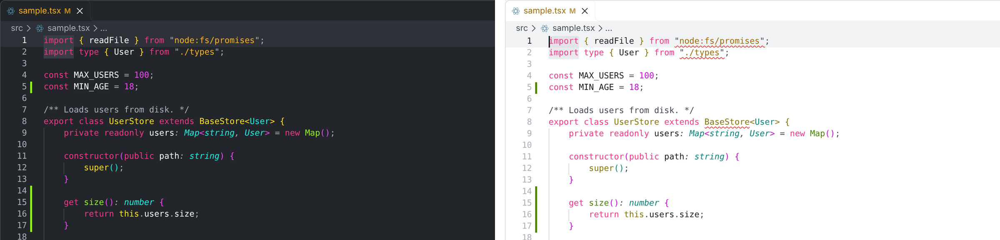

**PHP**

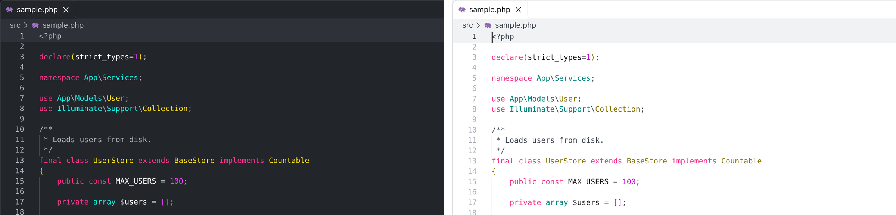

**Python**

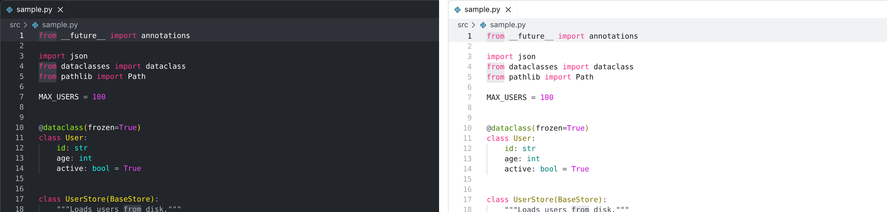

**Go**

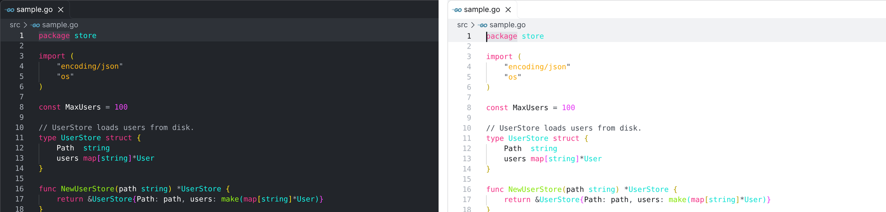

**Rust**

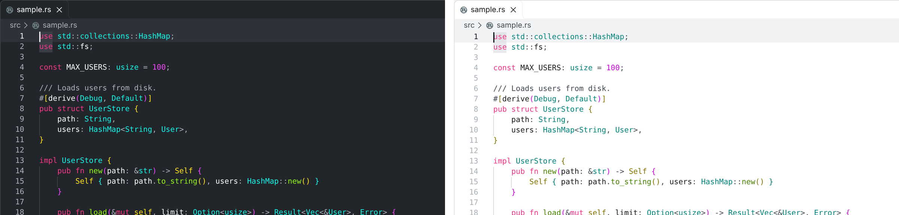

**Ruby**

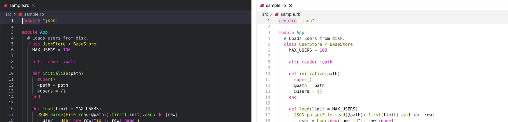

**CSS**

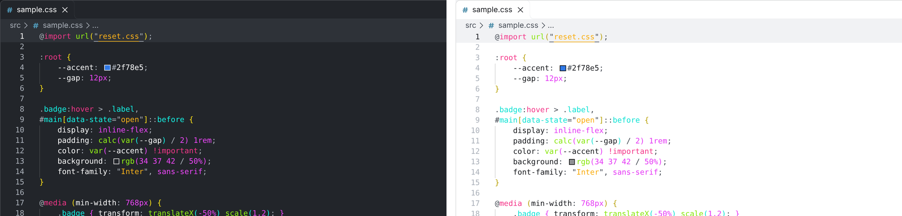

**HTML**

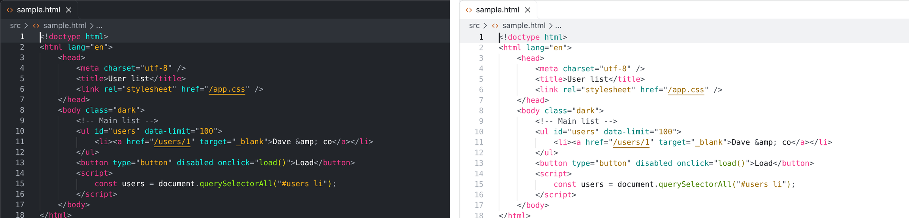

**Markdown**

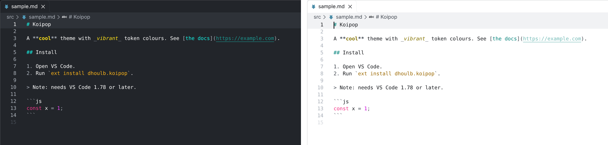

**SQL**

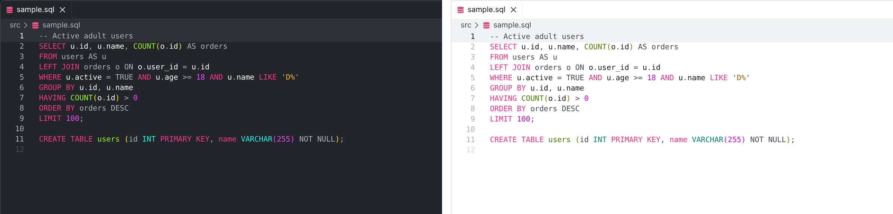

**YAML**

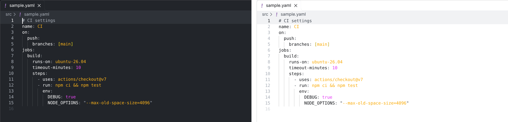

## Around the editor

**Terminal**: all 16 ANSI colors, git output and test results.

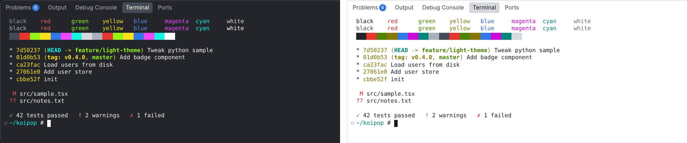

**Diff and source control**

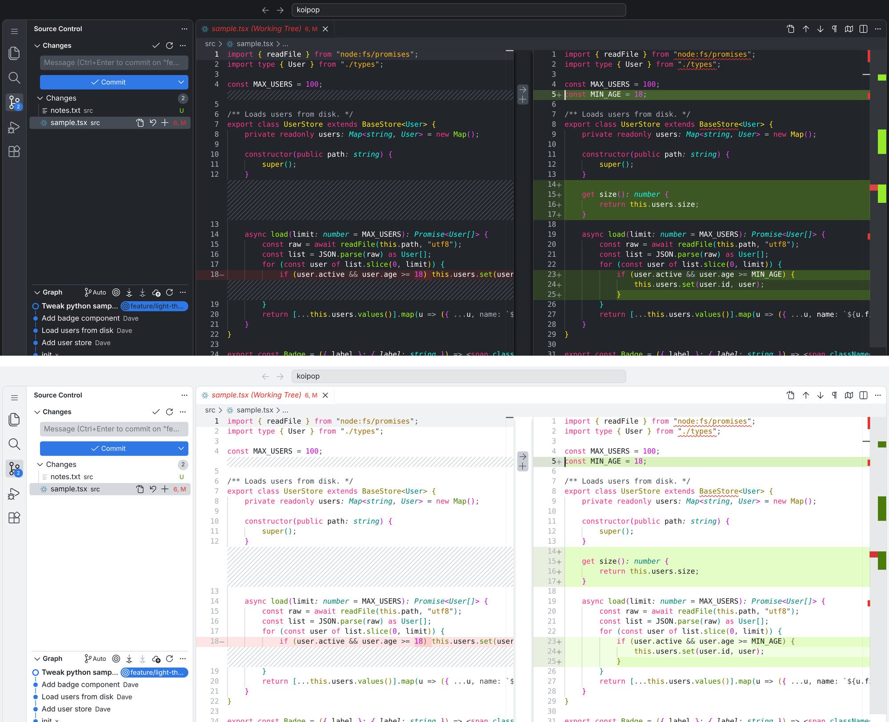

**Command palette**

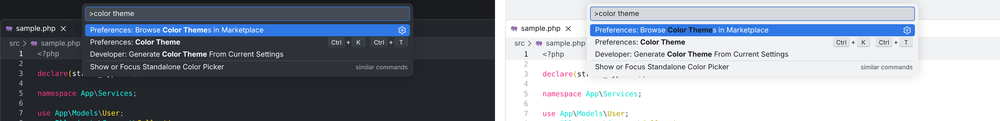

**Find**

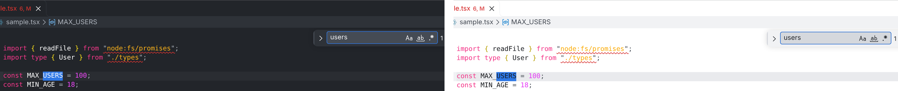

**Suggestions**

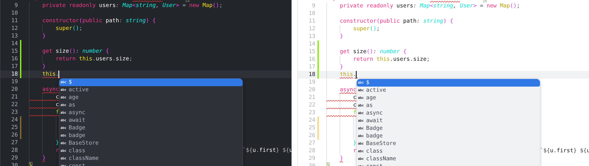

**Problems**

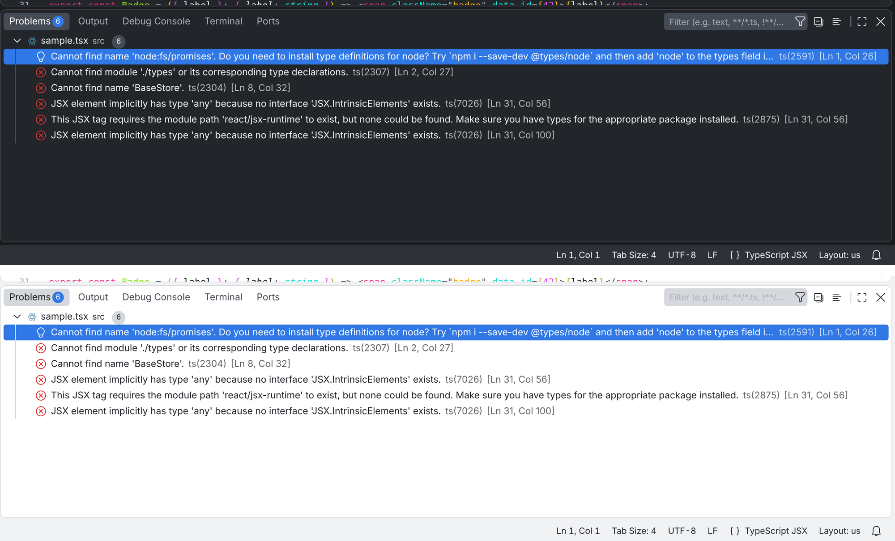

## Install

Search for **Koipop** in the Extensions view, or run `ext install dhoulb.koipop` from the command palette (`Ctrl+P` / `Cmd+P`). Then choose **Koipop Dark** or **Koipop Light** with **Preferences: Color Theme**.
